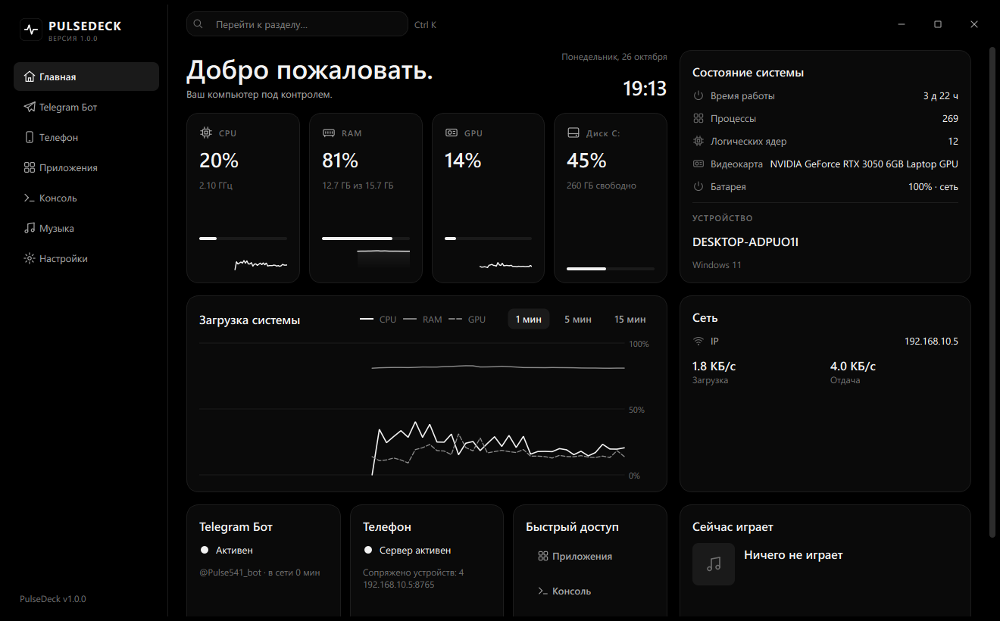
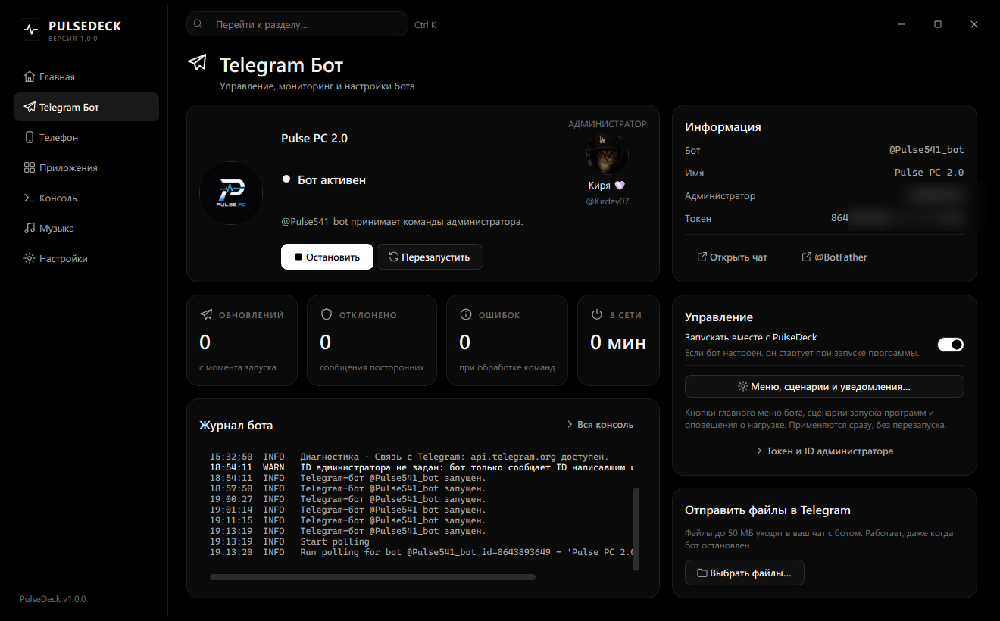
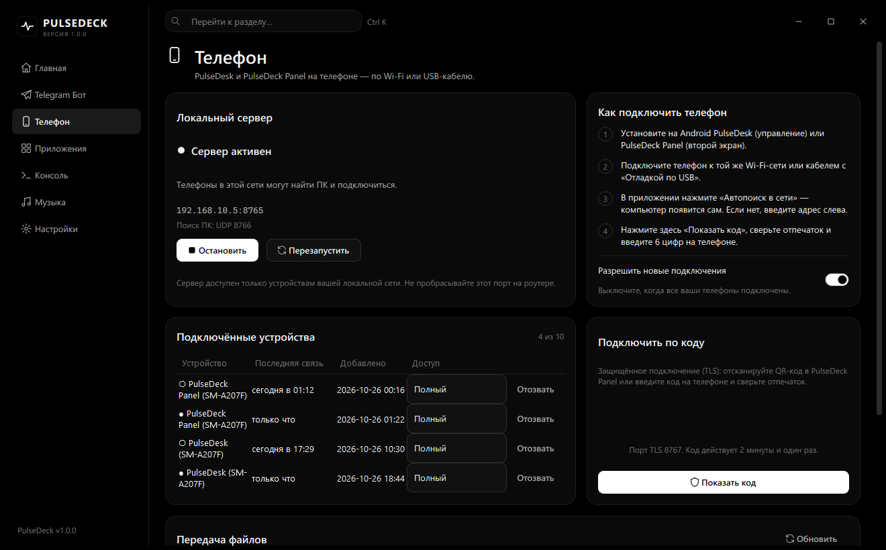
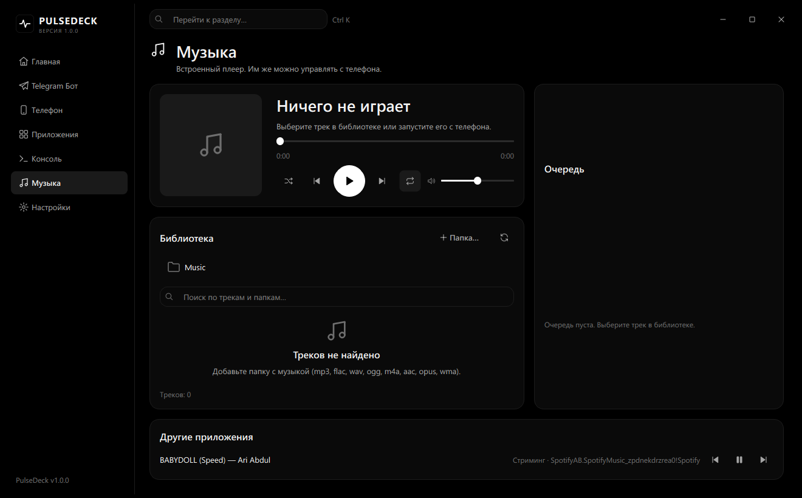
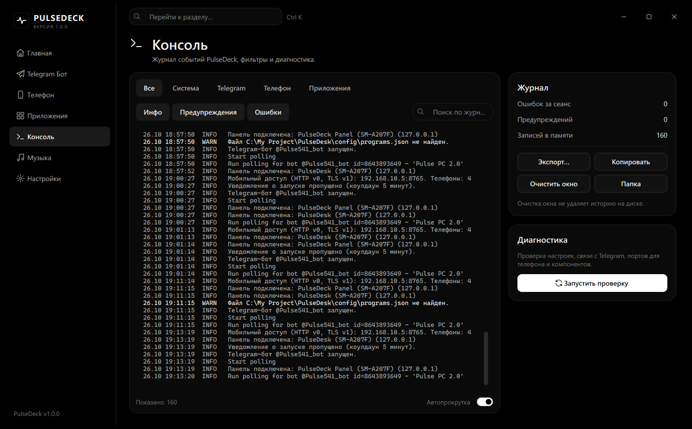
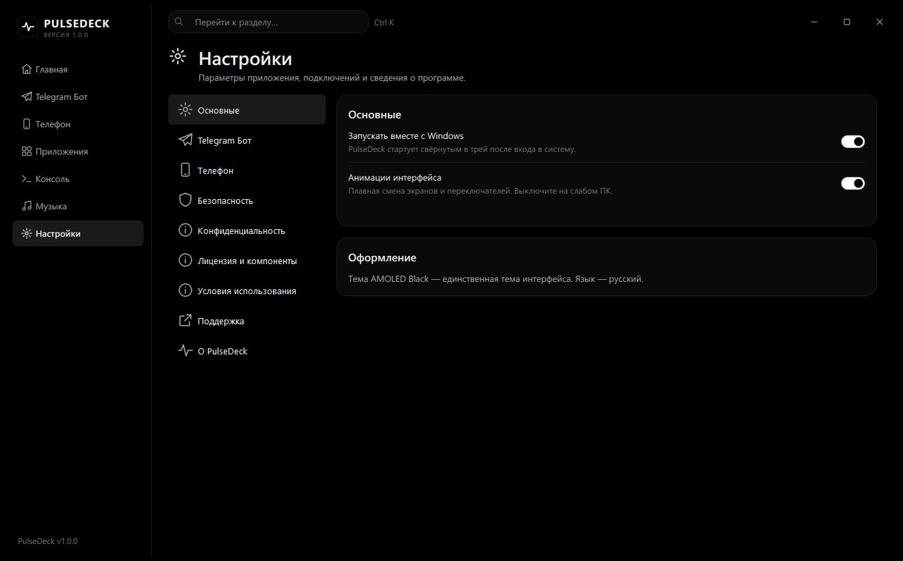

<div align="center">


# PulseDeck

**Управляйте своим Windows-компьютером из окна программы, через Telegram и с телефона.**

**Windows 10/11 · PySide6 · Telegram · Android · TLS**

[Скачать](https://github.com/kirdev07/PulseDeck---Kirdev_Software/releases/latest) · [Установка](УСТАНОВКА.md) · [Telegram-бот](BOT_GUIDE.md) · [PulseDesk для Android](https://github.com/kirdev07/PulseDeck-Mobile) · [PulseDeck Panel](https://github.com/kirdev07/PulseDesk-Panel_Kirdev-Software)

</div>



## О проекте

**PulseDeck** — центр управления вашим Windows-компьютером. Одна программа следит за системой,
запускает приложения, играет музыку и даёт доступ к ПК откуда угодно:

- **с компьютера** — окно в стиле AMOLED Black с живыми показателями CPU, RAM, GPU, дисков и сети;
- **из Telegram** — личный бот: питание, программы, файлы, скриншоты, музыка, уведомления о нагрузке;
- **с телефона** — приложения [PulseDesk](https://github.com/kirdev07/PulseDeck-Mobile) (пульт управления)
  и [PulseDeck Panel](https://github.com/kirdev07/PulseDesk-Panel_Kirdev-Software) (второй экран у монитора)
  по Wi-Fi или USB-кабелю, с защищённым подключением по коду.

Ставится обычным установщиком за минуту: Python и библиотеки уже внутри, права администратора не нужны.
Показывает только настоящие данные — если Windows чего-то не отдаёт, вы увидите «Недоступно», а не выдуманные цифры.

> **Важно:** PulseDeck выполняет действия с вашим компьютером удалённо. Используйте его только на своём
> ПК, храните токен бота в секрете и подключайте только свои телефоны.

## Возможности

| Экран | Что есть |
| --- | --- |
| **Главная** | CPU, RAM, GPU, диски, сеть, время работы, батарея — только реальные данные или «Недоступно»; графики нагрузки; состояние бота и телефона; что сейчас играет |
| **Telegram Бот** | Карточка профиля: аватарка и описание бота, ваш профиль администратора; запуск, остановка, перезапуск; понятные ошибки; счётчики; отправка файлов с ПК в Telegram; меню, сценарии и уведомления; журнал |
| **Телефон** | Сервер для телефонов; подключение по 6-значному коду (TLS); список телефонов: «полный доступ» или «только просмотр», отзыв доступа; USB-подключение; история передачи файлов |
| **Приложения** | Программы для быстрого запуска (общий список для ПК, Telegram и телефона), нагрузка запущенных, запуск и завершение |
| **Консоль** | Журнал по источникам, фильтры, поиск, экспорт; диагностика настроек, связи с Telegram и портов |
| **Музыка** | Встроенный плеер с очередью и библиотекой; управление музыкой других приложений (Spotify, Яндекс Музыка, браузер) |
| **Настройки** | Автозапуск, анимации, Telegram, телефон, безопасность, конфиденциальность, лицензия и компоненты |

Окно закрывается в трей: бот и сервер для телефона продолжают работать и не зависят друг от друга.

## Скриншоты

| | |
|---|---|
|  |  |
|  |  |
|  | |

## Управление через Telegram

| Раздел | Что можно делать |
| --- | --- |
| **Система** | Блокировка, сон, выключение и перезагрузка — с подтверждением |
| **Таймер** | Отложенное выключение или перезагрузка и их отмена |
| **Программы и сценарии** | Запуск настроенных приложений и наборов программ, завершение процессов |
| **Окна** | Список открытых окон, свернуть, развернуть, вывести на передний план |
| **Файлы** | Папки и диски, отправка файлов в Telegram, приём вложений на ПК, история передач |
| **Экран** | Скриншоты с выбором монитора |
| **Мультимедиа** | Треки, пауза, громкость, без звука |
| **Поиск и ссылки** | `/search`, `/s` или `? запрос`; ссылки из сообщений открываются на ПК |
| **Уведомления** | Нагрузка CPU, свободное место, завершение отслеживаемых процессов |

Бот отвечает только администратору (вашему Telegram ID). Файлы с ПК в Telegram — до 50 МБ,
из Telegram на ПК — до 20 МБ. Все команды: **[BOT_GUIDE.md](BOT_GUIDE.md)**.

## Приложения для телефона

| Приложение | Для чего |
|---|---|
| **[PulseDesk](https://github.com/kirdev07/PulseDeck-Mobile)** | Управление ПК с телефона: мониторинг, музыка с карточкой в шторке, файлы в обе стороны, процессы, окна, питание |
| **[PulseDeck Panel](https://github.com/kirdev07/PulseDesk-Panel_Kirdev-Software)** | Телефон у монитора как второй экран: часы, показатели ПК, музыка; тёмная и белая темы |

Оба приложения — Android 11+, подключаются по Wi-Fi или USB-кабелю и обновляются сами с GitHub.
Подключение: экран **«Телефон» → «Показать код»**, затем 6 цифр на телефоне.

## Установка

1. Скачайте **`PulseDeck-1.0.0-Setup.exe`** со страницы
   **[Releases](https://github.com/kirdev07/PulseDeck---Kirdev_Software/releases/latest)**.
2. Запустите. Права администратора не нужны: программа ставится для текущего пользователя.
3. Настройте Telegram-бота и подключите телефон.

Пошагово, с обновлением, переходом с версии 1.x и решением проблем: **[УСТАНОВКА.md](УСТАНОВКА.md)**.

## Безопасность

- Телефоны подключаются по одноразовому коду, связь — TLS с закреплённым сертификатом ПК.
- Сервер для телефона отвечает **только устройствам локальной сети**.
- У каждого телефона свой ключ; на ПК хранится только его хэш; доступ отзывается в один клик.
- Токен бота **зашифрован средствами Windows (DPAPI)** для вашей учётной записи.
- Бот выполняет команды только от вашего Telegram ID и записывает попытки посторонних.
- Телеметрии нет: данные уходят только в ваш бот и на ваши телефоны.

Подробнее: [Политика конфиденциальности](PRIVACY_POLICY.md) · [Условия использования](TERMS_OF_USE.md).

## Для разработчиков

```powershell
git clone https://github.com/kirdev07/PulseDeck---Kirdev_Software.git PulseDeck
cd PulseDeck
python -m venv .venv
.venv\Scripts\pip install -r requirements.txt -r requirements-optional.txt
.venv\Scripts\python -m pulse_pc
```

При запуске из исходников данные лежат в `config/` и `files/` рядом с кодом. Тесты (Telegram
проверяется на локальном имитаторе Bot API, сеть не нужна):

```powershell
.venv\Scripts\python -m unittest discover -s tests
```

Сборка установщика: [docs/BUILD.md](docs/BUILD.md). Протокол для телефонов:
[docs/PULSE_MOBILE_API_V1.md](docs/PULSE_MOBILE_API_V1.md).

```text
pulse_pc/          программа: окно, трей, службы, интерфейс
  core/            состояние, журнал, настройки, зашифрованные секреты
  services/        Telegram, сервер для телефона, метрики, программы, плеер
  ui/              тема, компоненты, экраны
modules/           обработчики Telegram, API для телефона, функции Windows
packaging/         PyInstaller + Inno Setup
tests/             автотесты
docs/              сборка, протоколы, скриншоты
```

## Частые вопросы

**Нужен ли Python?** Нет, он встроен в установщик.

**Работает ли телефон без Telegram?** Да, сервер для телефона не зависит от бота.

**Телефон не находит ПК.** Одна сеть Wi-Fi; разрешите PulseDeck в брандмауэре для частных сетей;
отключите изоляцию клиентов в роутере. Или подключите кабелем с «Отладкой по USB».

**Бот пишет «уже получает обновления в другом месте».** Запущена вторая копия программы с тем же
ботом или у бота настроен webhook.

**Linux или macOS?** Нет, PulseDeck использует функции Windows.

## Лицензия

© 2026 KirDev. Все права защищены. Исходный код открыт для ознакомления, но это **не разрешает**
копировать, изменять, распространять или продавать программу — действуют условия [LICENSE](LICENSE).
Сторонние компоненты — по их лицензиям: [THIRD_PARTY_NOTICES.md](THIRD_PARTY_NOTICES.md).

---

<div align="center">

**PulseDeck · KirDev Studio**

</div>
